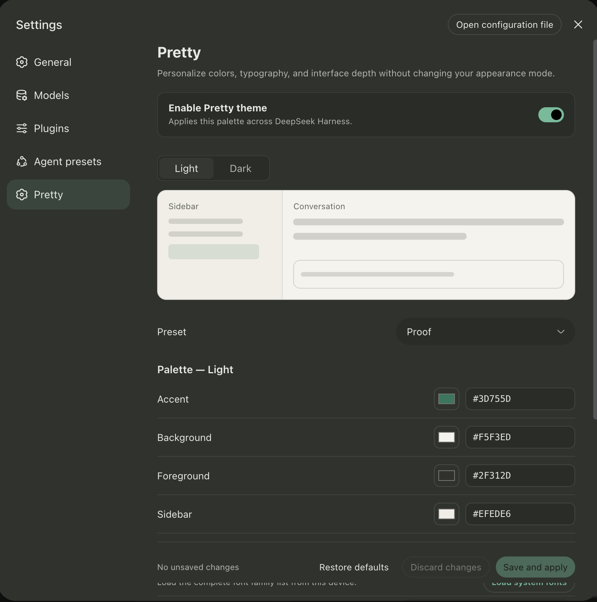

<div align="center">

# DSH Pretty Extension

**A polished theme editor for the DeepSeek Harness Web UI.**

Customize colors, typography, and interface depth from a native-looking **Settings → Pretty** page.

[](https://github.com/Rheasilvia/dsh-pretty-extension/stargazers)
[](https://github.com/Rheasilvia/dsh-pretty-extension/issues)
[](LICENSE)
[](https://github.com/topics/dsh-plugin)

[Features](#features) · [Installation](#installation) · [Usage](#usage) · [Development](#development) · [Contributing](#contributing)

</div>

<p align="center">
  
</p>

DSH Pretty Extension adds a complete theme editor to [DeepSeek Harness](https://github.com/deepseek-ai/deepseek-harness). Start from one of 28 presets or build your own light and dark palettes, preview every change in context, and save the result through DSH's settings system.

The extension uses the public DSH plugin, settings, slot, and theme APIs. It does not fork or patch the DeepSeek Harness source tree, and it stays disabled until you explicitly enable it.

## Features

| Capability | What it adds |
| --- | --- |
| **28 theme presets** | Ayu, Catppuccin, Codex, Dracula, GitHub, Nord, Proof, Tokyo Night, Vercel, Xcode, and more. |
| **Independent light and dark palettes** | Customize accent, background, foreground, and sidebar colors for each appearance mode. |
| **Live preview** | See the sidebar, conversation surface, and selected-session state before saving. |
| **Typography controls** | Choose separate UI and code fonts, including local macOS Font Book families when permitted by the browser. |
| **Interface depth** | Tune surfaces, borders, secondary text, hover states, and an optional translucent sidebar rendered at 82% opacity. |
| **Accessible color correction** | Low-contrast foreground colors are minimally adjusted to preserve a WCAG 4.5:1 text contrast ratio. |
| **Native DSH integration** | Uses DSH menus, semantic theme tokens, settings persistence, revision protection, and English/Chinese UI copy. |

## Installation

### Requirements

- [DeepSeek Harness](https://github.com/deepseek-ai/deepseek-harness) `0.2.0-rc.2` or later (Web or Desktop — the same package serves both, since the desktop app embeds the web UI).
- `pnpm` available on `PATH` when installing from the terminal or from the Web UI's **Plugins** page; `dsh plugin` forwards to pnpm. Installation from npm, the Plugin Market, or GitHub uses the published prebuilt bundles and needs no local build. The Desktop app uses the package manager bundled with the app.

### Install from npm

The package is published as `dsh-pretty-extension`. Pin the version you reviewed and restart DSH after the install:

```sh
dsh plugin --profile web add dsh-pretty-extension@0.3.2
dsh web
```

In the Desktop app, open **Plugins → Add plugin** and enter `dsh-pretty-extension@0.3.2`; the Desktop profile is managed by the app. npm installation uses the prebuilt Host and client bundles, so it does not require a Pretty-specific `allowBuilds` entry.

### Install from the Plugin Market

DSH has two plugin-market entry points. The package publishes the display metadata a plugin index reads: localized title and description, a 512×512 icon, `engines.dsh`, homepage, repository, and keywords. The curated community entry uses the same description and icon.

**Community Plugin Market.** Install the [dsh-market](https://github.com/dsh-market/dsh-market) plugin, restart DSH, then open **Plugins → Plugin Market**, select the **UI Enhancements** category, and search for **Pretty**:

```sh
dsh plugin --profile web add dshmarket
dsh web
```

The community catalog is curated in [awesome-dsh-plugin](https://github.com/awesome-dsh-plugin/awesome-dsh-plugin); new entries are reviewed by its maintainers before they appear.

**Official Discover tab (experimental).** DSH ships no plugin index by default. Open **Plugins**, find **Custom plugin indexes** under **Experimental plugins**, and switch it on. Then add the community catalog as an index source in **Plugins → Discover → Add index source**:

```text
https://cdn.jsdelivr.net/npm/dsh-plugin-catalog/index.json
```

Search for `dsh-pretty-extension`. Discover reads each listed npm version's published metadata.

If the plugin does not appear in either market yet, install it from npm above or from GitHub below; the package and the plugin are the same.

### Install from GitHub

DSH Web and Desktop both expose a **Plugins** page, which installs into the profile the UI is running — `web` in a browser, the reserved `desktop` profile in the Desktop app — so no profile name is needed.

1. Open DSH: run `dsh web` and open its loopback URL, or launch DeepSeek Harness Desktop.
2. Open **Plugins** in the sidebar, choose **Add plugin**, and enter:
   ```text
   github:Rheasilvia/dsh-pretty-extension
   ```
3. Install the plugin, then choose **Enable now** if the finished install offers it.
4. If DSH says a restart is required, restart the app or the `dsh web` process and reopen the UI.
5. Open **Settings → Pretty** and turn on **Enable Pretty theme**.

### Install from GitHub in the terminal

`dsh plugin --profile <name> <args>` forwards the remaining arguments to pnpm in the profile directory.

#### Web profile

Stop any running `dsh web` process, install the plugin, and start DSH again:

```sh
dsh plugin --profile web add github:Rheasilvia/dsh-pretty-extension
dsh web
```

#### Desktop profile

The `dsh` command installed from npm cannot manage the reserved Desktop profile and exits with:

```text
error: profile "desktop" is managed exclusively by the Electron application
```

Install from the **Plugins** page instead. For the terminal, open DeepSeek Harness Desktop once so it initializes its profile, install the `dsh` command shipped with the app (the **Manage dsh Command…** menu item), fully quit the app, then run:

```sh
dsh plugin --profile desktop add github:Rheasilvia/dsh-pretty-extension
```

Relaunch the app after the command finishes. If another `dsh` installation comes first on `PATH`, the command manager reports it; run the Desktop command by its full path instead.

> [!IMPORTANT]
> `dsh plugin add` and the Plugins page update the profile on disk. A running DSH process does not load a newly added bundle, so restart DSH after installing, updating, or removing the plugin (profiles with DSH's HMR enabled apply the change without a restart).

> [!NOTE]
> The repository ships reviewed, prebuilt Host and client bundles, source maps, and declarations under `lib/`. Git installation does not run plugin lifecycle scripts and does not require a Pretty-specific `allowBuilds` entry.

For a reproducible installation, pin the GitHub dependency to a reviewed commit. The `#<sha>` suffix works in the Plugins page and on the command line:

```sh
dsh plugin --profile web add github:Rheasilvia/dsh-pretty-extension#YOUR_COMMIT_SHA
```

### Link a local checkout

Use a linked checkout for development or testing:

```sh
git clone https://github.com/Rheasilvia/dsh-pretty-extension.git
cd dsh-pretty-extension
corepack enable
pnpm install
pnpm build
dsh plugin --profile web add link:.
dsh web
```

After editing the source, run `pnpm build` and restart `dsh web`. You do not need to add the linked plugin again. For Desktop development, run `dsh plugin --profile desktop add link:.` with the Desktop `dsh` command and relaunch the app.

## Usage

1. Start DSH Web with `dsh web` and open its loopback URL, normally `http://127.0.0.1:3080`, or launch DeepSeek Harness Desktop.
2. Open **Settings → Pretty**.
3. Turn on **Enable Pretty theme**.
4. Select the light or dark palette, then choose a preset or customize its colors, fonts, and interface effects.
5. Review the live preview and click **Save and apply**.

> [!NOTE]
> The Light and Dark buttons in Pretty select the palette you are editing. The active application appearance is still controlled by **Settings → General → Appearance**.

The plugin is disabled by default. Installing it alone does not change the DSH interface or write theme settings.

## Updating

For an npm installation or an unpinned GitHub installation, stop DSH Web and run:

```sh
dsh plugin --profile web update dsh-pretty-extension
dsh web
```

If you pinned a GitHub commit, install the new reviewed commit SHA explicitly instead. For a Desktop installation, run `dsh plugin --profile desktop update dsh-pretty-extension` with the Desktop `dsh` command, or remove the plugin and add it again from the **Plugins** page. If the Plugin Market installed the plugin, it can also update it from its own **Updates** list.

## Uninstalling

Stop DSH Web, remove the plugin, and restart the profile:

```sh
dsh plugin --profile web remove dsh-pretty-extension
dsh web
```

For a Desktop installation, run `dsh plugin --profile desktop remove dsh-pretty-extension` with the Desktop `dsh` command, or remove the bundle from the **Plugins** page.

## Troubleshooting

| Problem | What to do |
| --- | --- |
| **Pretty does not appear in Settings** | Confirm DSH is `0.2.0-rc.2` or later (`dsh --version`), the bundle is installed and enabled in the profile you are running (`web` for `dsh web`, `desktop` for the Desktop app), then fully restart DSH. |
| **“Pretty is read-only in this browser”** | Open DSH through `127.0.0.1`, `localhost`, or another loopback address. Remote browser sessions intentionally use memory settings and cannot persist Pretty changes. |
| **The Host settings provider is unavailable** | Use the standard Web profile and restart it after installing or rebuilding the plugin. |
| **Local fonts are unavailable** | Local Font Access requires browser support, a loopback or secure context, and explicit permission. Built-in font stacks remain available. |

## Configuration and privacy

Pretty settings persist through DSH's configuration editor into the active profile's `cordis.patch.yml`, keyed by the plugin's `ui-pretty` entry id. Settings written by plugin versions before 0.3.0 in `$DSH_HOME/settings.yaml` are imported once by DSH itself on the first startup after the upgrade. **Restore defaults** clears the `theme` field override and lets the original DSH theme tokens take effect again.

Local Font Access is requested only after you click **Load system fonts**. The plugin stores the selected font family name; it does not copy or upload font files.

## Development

Local development requires Node.js `^22.19.0 || >=24.0.0` and pnpm 11.

| Command | Description |
| --- | --- |
| `pnpm typecheck` | Run the TypeScript type checker. |
| `pnpm test` | Run domain, controller, component, accessibility, and settings integration tests. |
| `pnpm build` | Build the Host entry, browser client bundle, declarations, and inline CSS Modules. |
| `pnpm check` | Run type checking, tests, and a production build. |
| `pnpm check:dist` | Rebuild and verify that the committed `lib/` tree remains unchanged. |
| `pnpm watch` | Rebuild when source files change. |
| `pnpm pack --dry-run` | Inspect the publishable package contents. |

`lib/` is generated by `pnpm build` and committed so Git installations remain scriptless. Never edit it by hand. After changing source or build tooling, run `pnpm check` and commit the regenerated `lib/` with the source change. `pnpm check:dist` must then pass from the clean commit and in CI.

### Releasing

The version in `package.json` is the release version. Before the first tag, configure npm trusted publishing for `Rheasilvia/dsh-pretty-extension` with the workflow file `release.yml`; the release workflow authenticates through GitHub OIDC, so no npm token is stored in the repository. Then tag the reviewed commit and push the tag:

```sh
git tag v0.3.2
git push origin v0.3.2
```

`.github/workflows/release.yml` verifies that the tag matches `package.json`, runs `pnpm check`, `pnpm check:dist`, and `pnpm pack --dry-run`, then publishes with `npm publish --provenance --access public`. The equivalent manual publish, from an authenticated npm session on a clean checkout, is:

```sh
pnpm check && pnpm check:dist && pnpm pack --dry-run
npm publish --provenance --access public
npm view dsh-pretty-extension version
```

### Project structure

```text
src/
├── index.ts                         # Host composition root and settings schema
├── settings/pretty-settings.ts      # Persistent configuration contract
└── client/
    ├── index.ts                     # Browser composition root
    ├── locales.ts                   # English and Chinese UI copy
    └── pretty/
        ├── PrettySection/           # Settings page and state branches
        ├── components/              # UI components and CSS Modules
        ├── state/                   # Config form adapter, store, and controller
        └── theme/                   # Presets, font catalog, and token derivation
```

The Host exports the `Config` schema that DSH serves as the `ui-pretty` settings form. The browser client injects the Pretty page into DSH Settings and applies colors and fonts through an owned theme-token override. Adapters keep DSH services outside the UI and theme domain logic.

## Contributing

Issues and pull requests are welcome. Please read [CONTRIBUTING.md](CONTRIBUTING.md) and run the verification gates before opening a PR:

```sh
pnpm check
pnpm check:dist
pnpm pack --dry-run
```

## License

Released under the [MIT License](LICENSE).

---

<p align="center">
  A community-maintained plugin for DeepSeek Harness. This project is not affiliated with or endorsed by DeepSeek AI.
</p>
